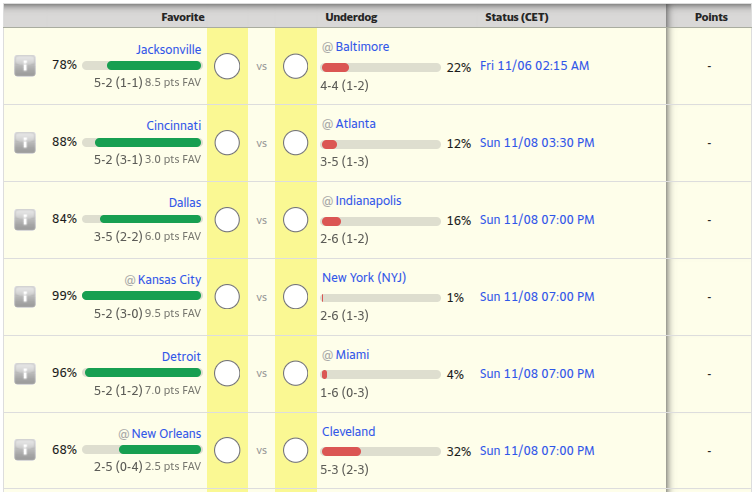

# Better Yahoo Pick'em Form

A userscript that improves the picks form of Yahoo! Fantasy Football **Pick'em** games, for both **College Football (CFB)** and the **NFL**.

Yahoo shows the pick distribution, the team records and the spread on another view of the page, so making your picks means constantly moving your eyes back and forth or clicking "matchup information" for every game, if you rely on those informations to do so. This script displays them **directly under each team** of the form.



## What it shows

Under each team, for every game of the form:

- **Pick distribution**: the percentage of players in your group who picked that team, with a bar (green for the most picked team, red for the other one).
- **Record**: the team's overall W-L record, followed by its home or away record in parentheses, as Yahoo displays it.
- **Spread**: the points spread in favor of the favorite (`x.x pts FAV`).

## Installation

1. Install a userscript manager, such as [Tampermonkey](https://www.tampermonkey.net/) (recommended) or Violentmonkey.
   - On Chrome and Edge, you may need to enable **Allow User Scripts** on the extension's details page (or Developer Mode on older versions), otherwise no script will run.
2. In *Tampermonkey*, go to the **Utilities** tab, paste this URL in the **Import from URL** field (at the bottom of the page) and click **Install**:

   ```
   https://raw.githubusercontent.com/WalsGit/Better-yahoo-pickem/main/BetterYahooPickem.user.js
   ```

You can also install it from one of these sources:

- Greasy Fork: *link to be added*
- OpenUserJS: *link to be added*

## Supported pages

The script runs on the pick forms of your groups:

| Game | Page |
| --- | --- |
| NFL Pick'em | `https://football.fantasysports.yahoo.com/pickem/{group id}/{user id}` |
| College football Pick'em | `https://football.fantasysports.yahoo.com/college/{group id}/{user id}` |

It does nothing on pages without a pick form (past weeks, upcoming weeks whose games are not set yet, or viewing other users' picks).

## How it works

The script reads the "matchup information" page Yahoo links from the form, which contains the pick distribution of all games, with a single request. Each game of that page is then matched to its row in the form through the teams' Yahoo page URLs, and the data is displayed under the team names. Nothing is sent anywhere else, and the script needs no special permission.

## Limitations

- It depends on Yahoo's page structure. If Yahoo changes it, the script may stop displaying data until it is updated. Selectors are grouped in the `CONFIG` object at the top of the script.

## Troubleshooting

- Nothing is displayed: make sure the page has a pick form, that the script is enabled in your userscript manager, and (on Chrome and Edge) that user scripts are allowed.
- Open the browser console (F12). The script logs its warnings with the `[BYP]` prefix, for example when it cannot load the pick distribution or match a game.
- Please report problems on the [issue tracker](https://github.com/WalsGit/Better-yahoo-pickem/issues).

## Notes

- Made with Claude Code.

## License

[MIT](LICENSE) © 2026 Wa!id
